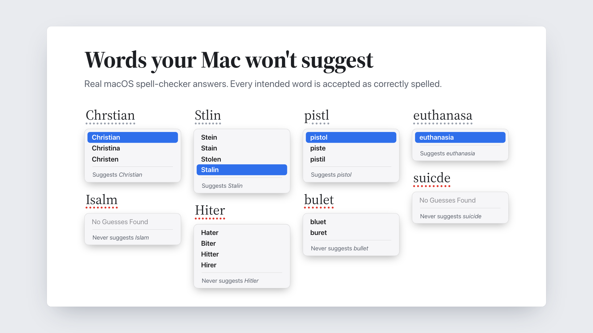
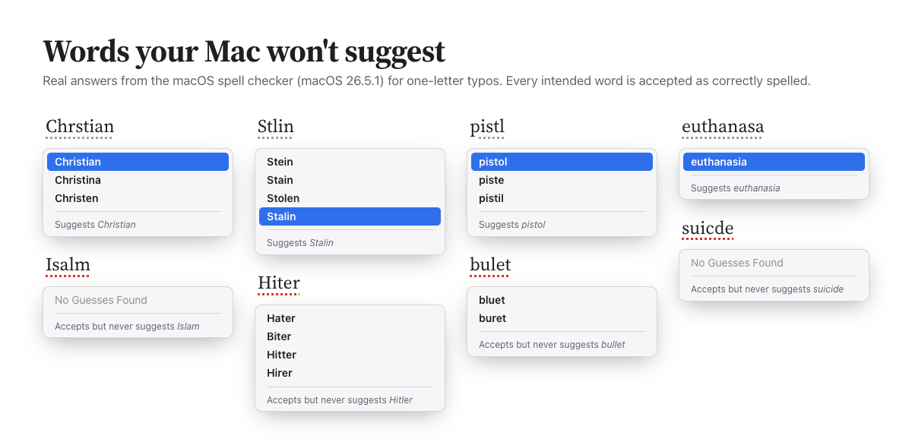
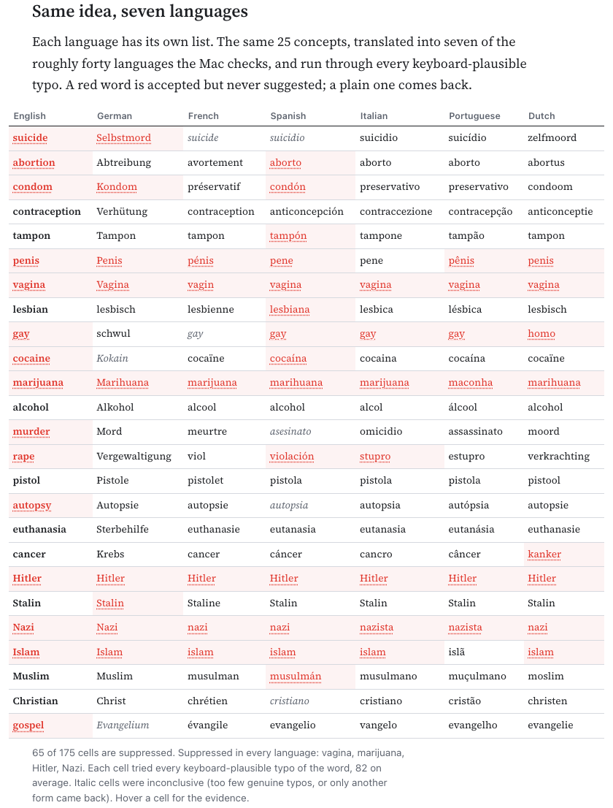
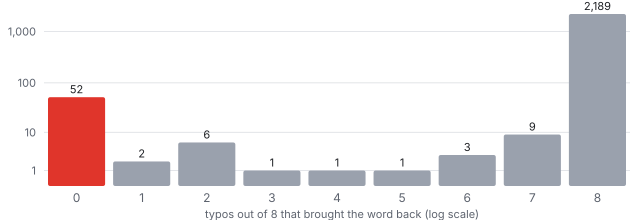

# nosuggest

[](assets/launch.mp4)

**The macOS spell checker accepts 1,705 English words as correctly spelled
but never offers them as a correction.** Type *suicde* and it has no
suggestions at all, though it knows *suicide*. *Aborion*, *murdr*, *Isalm*,
*gospl* and *Hiter* get the same treatment, while *lesbain*, *euthanasa*,
*Chrstian* and *Stlin* come back right away. nosuggest finds these words from
the outside: it sent 123,537 one-letter typos of 108,931 accepted words to the
real `NSSpellChecker` (the one behind TextEdit, Mail, Notes, Pages and Safari
text fields) and recorded which words never come back. Ordinary words come
back from 99.3% to 99.8% of their typos; these never do. A seeded audit of
200 of them found an obvious sensitive meaning for 92% and no apparent reason
for 3.5%.

**Live explorer: https://thewingthewong.github.io/nosuggest/**



This week the Guardian reported on Apple's "grey list" of phrases the iPhone
keyboard won't predict, which Derik Kauffman recovered from iOS
([Swipeblocked](https://swipeblocked.com)). That list is made of two- to
six-word phrases and only affects predictions and swipe typing. The spell
checker's list is a separate mechanism: it works on single words, it covers
medicine, religion, crime and history as well as profanity, and 1,635 of the
1,705 words here don't appear in any of the 4,513 iOS entries at all.

## Results (macOS 26.5.1, build 25F80, English)

| verdict | words | meaning |
|---|---:|---|
| suggested | 107,031 | came back from at least one typo |
| suppressed | 1,705 | accepted, never came back from 6 to 8 typos |
| related | 187 | only another form came back (*Bostns* gives *Boston's*) |
| borderline | 8 | never came back, but fewer than 6 genuine typos to test |
| rejected | 19,718 | the checker flags the word itself as misspelled |
| untestable | 131 | internal capitals (*BigQuery*) or no genuine typos to try |

Of the 1,705 suppressed words:

- **52.9%** of their typos got an empty guess list, not merely a list
  without the word. Asked about *suicde*, *aborion*, *murdr* or *Isalm*, the
  checker says "No Guesses Found".
- **1,699** are also missing from completions of their own prefix, and
  **1,697** are never produced by autocorrect. Same list, all three channels.
- **1,417** missed on at least two *unambiguous* typos: typos whose only
  neighbour within one edit, in a 665,000-word list, is the word itself.
- **1,590** are lowercase words; 115 are capitalised (Hitler, Auschwitz,
  Islam, Gospel, Satan, Shiite, Viagra...).

By editorial category (rules in [`data/categories.tsv`](data/categories.tsv)):

| category | words | examples |
|---|---:|---|
| sex and the body | 571 | penis, vagina, arousal, bisexual, lovers, titillate, panties |
| profanity and insults | 251 | the usual, plus *dwarf*, *midget*, *redneck*, *dammit* |
| violence, crime and weapons | 217 | murder, rape, bullet, abduct, behead, hijack, slave, terrorism |
| death and medicine | 152 | suicide, autopsy, amputee, colon, cervix, chlamydia, Ebola, urine, cyanide |
| slurs | 105 | (not reproduced here; blurred by default on the live page) |
| religion | 101 | Islam, gospel, Psalms, sacrament, Satan, demon, sharia, jihad, gods |
| race and ethnicity | 84 | Arab, Afro, Aryan, ghetto, skinhead |
| drugs and alcohol | 76 | cocaine, cannabis, marijuana, morphine, drunk, binge |
| nazism and hate groups | 50 | Hitler, Nazi, Auschwitz, Dachau, Gestapo, Klan, swastika, fascism |
| reproductive health | 34 | abortion, condom, afterbirth, circumcision, castration |
| other / names and places | 62 | *Hallie*, *Mollie*, *Yaroslavl*, *moshes*, *analeptics* |

Some contrasts from the same run: *Stalin* is suggested and *Hitler* is not;
*Christian* and *Muslim* are suggested and *Islam* is not; *pistol* and
*firearm* are, *bullet* is not; *euthanasia*, *overdose*, *tampon*,
*contraception* and *lesbian* are suggested, *suicide*, *abortion*, *condom*
and *gay* (probed separately, it is three letters) are not. Political names
are untouched: *Trump*, *Putin*, *Tibet*, *Taiwan*, *Kashmir*, *Palestine* and
*Gaza* are all suggested, the opposite of the iOS keyboard list, which is full
of political phrases.

Hunspell, the open-source checker in LibreOffice, marks 27 entries in its
`en_US` dictionary `NOSUGGEST`. macOS suppresses 23 of them, rejects 2 as
misspellings, is borderline on 1 and lacks 1. None is suggested.

## Every language has its own list

The same 25 concepts, translated and probed with eight typos each in the
seven languages below. Red means accepted but never suggested.



67 of the 175 cells are suppressed. *Hitler*, *Nazi*, *marijuana* and
*vagina* are suppressed in all seven languages and *Islam* in six (not
Portuguese). The rest varies: *abortion* only in English and Spanish, *suicide*
in English, German, French and Spanish, *Stalin* only in German, *lesbian*,
*tampon* and *Muslim* only in Spanish. Dutch suppresses *kanker* (cancer), which
is also one of the commonest Dutch swear words. The verdicts are nearly all 8/8
or 0/8, so there is little doubt about any cell; the few inconclusive ones are
in italics on the [live page](https://thewingthewong.github.io/nosuggest/).

## Quickstart

Needs a Mac with Xcode or the Command Line Tools. No other dependencies.

```
git clone https://github.com/TheWingTheWong/nosuggest && cd nosuggest
swift run -c release nosuggest word suicide lesbian
```

```
suicide  ->  SUPPRESSED   (0/8 typos brought it back)
   no  suiide deletion [suite, suited]
   no  suciide transposition [succeed]
   no  suidide substitution []
   no  suiccide insertion []
   no  sucide deletion [succeed]
   no  suiicde transposition []
   no  sujcide substitution []
   no  suiicide insertion []
  completions of "suicid" include it: no
  autocorrect ever produces it: no

lesbian  ->  SUGGESTED   (8/8 typos brought it back)
  yes  lesian deletion [lesbian, lesion, Lesia]
  yes  lebsian transposition [lesbian]
  yes  lesfian substitution [lesbian]
  yes  lesbbian insertion [lesbian]
  yes  lebian deletion [lesbian, Debian]
  yes  lesiban transposition [lesbian]
  yes  leabian substitution [lesbian]
  yes  lessbian insertion [lesbian]
```

The full census downloads the SCOWL word lists (pinned by hash), probes
every word and runs the control sample. It takes about 30 minutes, because
the system spell server answers about 175 guesses a second no matter how many
clients ask:

```
./scripts/run-census.sh          # -> data/<your macOS version>/
./scripts/build-site.sh          # -> docs/data/ for the explorer
swift run -c release nosuggest concepts > docs/data/concepts.json
```

Other commands: `nosuggest guesses suicde=suicide` prints the checker's raw
answers as JSON; `nosuggest probe --lexicon words.txt` runs your own list;
`--language de` switches language.

## How it works

**The probe.** For each word the checker accepts, nosuggest builds up to
eight one-edit typos that a person might make: a deleted letter, two letters
swapped, a neighbouring QWERTY key, a doubled letter. It never touches the
first letter, because spell checkers rely on it heavily. A typo that is itself
an accepted word (*form* for *from*) is skipped, because it tests nothing. Each
remaining typo goes to `guesses(forWordRange:in:language:inSpellDocumentWithTag:)`
with an explicit language and no automatic language detection.

**Verdicts.** The probe stops at the first typo that brings the word back
(**suggested**). A word that never comes back is checked once more: if some
guess was another form of the same word (*Bostns* gives *Boston, Boston's*),
it is a ranking quirk and is labelled **related**, not suppressed. Otherwise,
with at least six genuine typos tested, the word is **suppressed**. For those
words the probe also records whether the word appears in the completions of
its own prefix and whether autocorrect ever produces it.

**Unambiguous typos.** A typo is unambiguous when the word is its only
neighbour within one edit in a 665,000-word list (SCOWL up to size 95, the
largest and strictest set). Asked about such a typo, a checker that has the
word has no competing candidate to offer. 1,417 of the suppressed words
missed on two or more of these; ordinary words come back from 99.6% of them.

**The control.** A checker can miss the right word for ordinary reasons, so
the census also ran all eight typos, with no early stop, on 3,000 random
lexicon words (2,247 lowercase and 243 capitalised words that the checker
accepts). Ordinary words come back from 99.3% (deletions) to 99.8%
(substitutions) of their typos; capitalised words from 98.0% to 99.2%.



The histogram (lowercase words) is bimodal. 2,174 words came back from all
eight typos and 52 from none (3 of those offered another form of the word),
with almost nothing in between. The words in between are odd plurals
and rare forms (*blockings*, *whitebaits*, *muchnesses*), and none of them
reaches zero.

**The audit.** A statistical model can't say whether a zero is deliberate, so
I labelled two samples by hand, one judgement per word, and published the
labels in [`data/26.5.1/`](data/26.5.1/):

| sample | n | obvious sensitive meaning | spelled like one | no apparent reason |
|---|---:|---:|---:|---:|
| every control word judged suppressed (49 lowercase, 2 capitalised) | 51 | 46 | 4 (*copulatives*, *daemons*, *fyke*, *niggles*) | 1 (*rabidness*) |
| 200 words drawn at random from the list (seed 20261108) | 200 | 184 | 9 (*analeptics*, *rapeseed*, *rectus*, *virginals*, ...) | 7 (3.5%, 95% CI 1.7-7.0%) |

Projected over the list, about 60 words (95% CI 29-120) have no apparent
reason: *Balkan*, *Yaroslavl*, *moshes*, *pontes*. Those are either a
checker quirk or a reason I can't see. A separate rerun of 400 words, 200 from
each side, gave 400 identical verdicts (`scripts/stability.sh`).

## Design decisions and trade-offs

- **Black box, not reverse engineering.** The iOS list was recovered by
  decoding Apple's hash tables, which is exact but has to be redone whenever
  the format changes. nosuggest only uses public AppKit API, so anyone can
  rerun it on any macOS version in one command and diff the result. The cost
  is that it can only find words that are in its input list, and it can't see
  *why* a word is suppressed.
- **Conservative by construction.** Case-insensitive matching (if *Suicide*
  were offered for *suicde*, that would count as suggested), the related-form
  rule, skipping typos that are real words, and the strictest neighbour list
  all push errors toward "suggested". The list is a lower bound.
- **Child processes, not threads.** `NSSpellChecker` is not documented as
  thread-safe and the spell server is the bottleneck anyway: one client gets
  about 100 guesses a second, four get about 175 in total. `--jobs` splits
  the lexicon round-robin across child processes.
- **Swift, AppKit only.** No dependencies. The probing logic lives in
  `NoSuggestCore`, which has no AppKit import and is tested against a
  simulated checker with planted suppressed words and a configurable miss rate.

## Tests

`swift test` runs 23 tests, most of them property tests over randomised
inputs:

- every typo in every battery is exactly one optimal-string-alignment edit
  from its source and keeps the first letter;
- `allEdits` equals the distance-one neighbourhood, checked in both
  directions;
- with a simulated checker that drops 30% of correct candidates, the prober
  finds every planted word and flags at most 2 of about 11,000 ordinary words
  (the theoretical rate is 0.3^8, about 7 in 100,000);
- the audit parser counts labels and computes a Wilson interval that
  brackets the observed rate;
- the related-form rule accepts real inflections (*Bostons*/*Boston's*,
  *bared*/*bare*) and rejects the lookalikes the real checker returned for
  suppressed words (*Hitler*/*Hitter*, *suicide*/*suited*, *condom*/*condo*).

CI runs the tests on a GitHub macOS runner, then runs a live probe against
that runner's spell checker and prints the result.

## Limitations

- **Input-bounded.** Only words in SCOWL (size 70 and below, about 129,000
  entries) were probed. Slang, new coinages and most names aren't there.
  Words shorter than four letters (*sex*, *gay*) were skipped in the census
  because their typos collide with too many other words, though
  `nosuggest word` will probe them.
- **Names are noisy.** The capitalised list includes first names (*Hallie*,
  *Mollie*, *Shawna*) that may simply be low-frequency rather than deliberately
  suppressed. The capitalised control quantifies this; treat individual
  names with caution.
- **Lookalikes.** Some suppressed words look like collateral damage from
  matching on spelling: *analeptics*, *copula*, *colones*, *clansman*,
  *cockier*. That is an inference from the pattern, not something the probe
  can confirm.
- **One machine, one version.** This census is macOS 26.5.1 (25F80). iOS's
  `UITextChecker` likely shares the engine but was not tested.
- **The categories are mine.** `data/categories.tsv` is a set of hand-written
  rules applied after the fact to make the list browsable. Apple's own
  grouping, if there is one, isn't visible from outside.

## Data

- `data/<version>/suppressed-en.txt`: the list, one word per line.
- `data/<version>/probe-en.jsonl.gz`: every word, every typo, every guess.
- `data/<version>/control-en.jsonl`: the control sample.
- `data/<version>/summary-en.md`: the numbers in this README.
- `docs/data/`: what the explorer loads.

## References

- The Guardian, ["Struggling to spell 'male chauvinist pig'? Apple's grey list
  means your iPhone won't help you"](https://www.theguardian.com/technology/2026/nov/06/struggling-to-spell-male-chauvinist-pig-apple-grey-list-means-your-iphone-wont-help-you),
  6 November 2026 (456 points on Hacker News).
- Derik Kauffman, [Swipeblocked](https://swipeblocked.com) and
  [github.com/derikk/swipeblocked](https://github.com/derikk/swipeblocked):
  the iOS keyboard blocklist, recovered from iOS 27.0.
- Kevin Atkinson, [SCOWL](http://wordlist.aspell.net/) (Spell Checking
  Oriented Word Lists), version 2020.12.07.
- Hunspell `en_US` dictionary as shipped by
  [LibreOffice](https://github.com/LibreOffice/dictionaries), whose `NOSUGGEST`
  flag does the same job in the open.
- Apple, [`NSSpellChecker`](https://developer.apple.com/documentation/appkit/nsspellchecker).

## License

MIT. The word lists are downloaded at run time and keep their own licenses.
